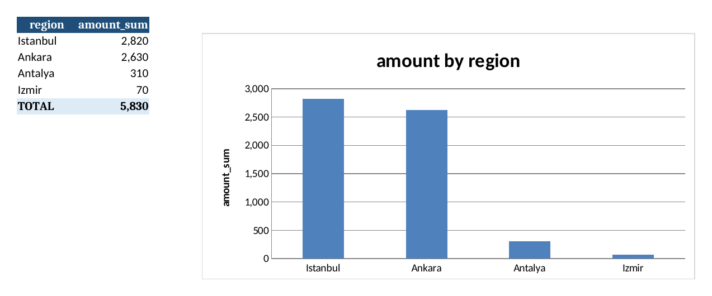

# Python Automation Toolkit

`autotool` is a command-line toolkit for the repetitive office tasks that eat up hours: combining Excel/CSV exports, cleaning messy data, building summary reports, handling PDFs and renaming piles of files.

Every command is tested, previews destructive actions first, and works on Windows, macOS and Linux.



## What it does

| Command | What it automates |
| --- | --- |
| `autotool merge` | Combine many CSV/Excel files into one table, even when their columns differ slightly |
| `autotool clean` | Fix a messy export: snake_case headers, trimmed text, no empty or duplicate rows |
| `autotool report` | Turn a table into a formatted Excel report with totals and a bar chart |
| `autotool pdf merge` | Merge PDFs in a given order |
| `autotool pdf split` | Split a PDF into single pages or page ranges like `1-3,4,5-8` |
| `autotool pdf text` | Extract the text of every page |
| `autotool rename` | Bulk-rename files from a template, with a preview before anything changes |

## Install

Requires Python 3.10+.

```bash
git clone https://github.com/zafwr/python-automation-toolkit.git
cd python-automation-toolkit
pip install -e .
autotool --help
```

## Examples

The `examples/` folder has two small, fictional sales exports with typical problems: different separators (`,` vs `;`), a column that only exists in one file, extra spaces, a blank row and a duplicate order.

### Merge monthly exports and build a report

```bash
autotool merge examples/sales_january.csv examples/sales_february.csv -o output/all_sales.xlsx
autotool report output/all_sales.xlsx --by region --value amount -o output/sales_report.xlsx
```

```
✓ Merged 2 files → output/all_sales.xlsx (10 rows, 1 empty/duplicate rows removed)
 sum of amount by region
┏━━━━━━━━━━┳━━━━━━━━━━━━┓
┃ region   ┃ amount_sum ┃
┡━━━━━━━━━━╇━━━━━━━━━━━━┩
│ Istanbul │ 2820       │
│ Ankara   │ 2630       │
│ Antalya  │ 310        │
│ Izmir    │ 70         │
└──────────┴────────────┘
✓ Report saved to output/sales_report.xlsx
```

The merged file gets a `source_file` column so you always know where each row came from. The report workbook has a **Summary** sheet (sorted totals, a TOTAL row and a bar chart, set to print on one landscape page) and a **Data** sheet with the cleaned rows. Use `--agg mean|count|min|max` for other summaries.

### Clean a single export

```bash
autotool clean "Customer Export.csv" -o customers_clean.xlsx
```

Headers like ` Customer Name ` or `Şehir` become `customer_name` and `sehir`; extra spaces are collapsed; blank and duplicate rows are dropped. CSV separators (comma, semicolon, tab) are detected automatically, and CSV output includes a UTF-8 BOM so Excel shows Turkish and other accented characters correctly.

### PDFs

```bash
autotool pdf merge cover.pdf report.pdf appendix.pdf -o full_report.pdf
autotool pdf split full_report.pdf --ranges "1-2,3-10" -d parts/
autotool pdf text invoice.pdf -o invoice.txt
```

### Bulk rename (preview first)

```bash
autotool rename ./invoices --pattern "*.pdf" --template "{date}_{index:03}_{slug}{ext}"
```

```
                     Rename plan (preview)
┏━━━━━━━━━━━━━━━━━━━━━━━┳━━━━━━━━━━━━━━━━━━━━━━━━━━━━━━━━━━━━━━┓
┃ Current name          ┃ New name                             ┃
┡━━━━━━━━━━━━━━━━━━━━━━━╇━━━━━━━━━━━━━━━━━━━━━━━━━━━━━━━━━━━━━━┩
│ Fatura Ocak 2026.pdf  │ 2026-01-31_001_fatura-ocak-2026.pdf  │
│ Fatura Şubat 2026.pdf │ 2026-02-28_002_fatura-subat-2026.pdf │
└───────────────────────┴──────────────────────────────────────┘
Preview only. Run again with --apply to rename.
```

Template fields: `{index}` (supports `{index:03}`), `{stem}`, `{slug}`, `{date}` (file modified date) and `{ext}`. The tool refuses to run if two files would get the same name or an existing file would be overwritten, and it renames in two phases so swaps such as `1.txt → 0.txt, 2.txt → 1.txt` are safe.

## Use it from Python

Each command is a thin wrapper around a plain function, so the same logic can be used in scripts or notebooks:

```python
from pathlib import Path
from autotool.tables import merge_tables, clean
from autotool.report import summarize, write_report

df = clean(merge_tables(list(Path("exports").glob("*.csv"))), normalize_headers=False)
write_report(df, summarize(df, "region", "amount"), Path("report.xlsx"))
```

## Development

```bash
pip install -e ".[dev]"
pytest
```

20 tests cover header normalization, cleaning, separator detection, merging with mismatched columns, report sheets/totals/chart, PDF merge/split/text, rename safety checks and the CLI end to end. CI runs them on Python 3.10, 3.12 and 3.13 and smoke-tests the CLI on the example files.

```
src/autotool/
  cli.py        Typer commands and terminal output
  tables.py     Read, clean and merge CSV/Excel
  report.py     Summaries and the formatted Excel report
  pdftools.py   PDF merge, split and text extraction
  rename.py     Safe bulk renaming
tests/
examples/       Fictional sample exports
```

## License

MIT
